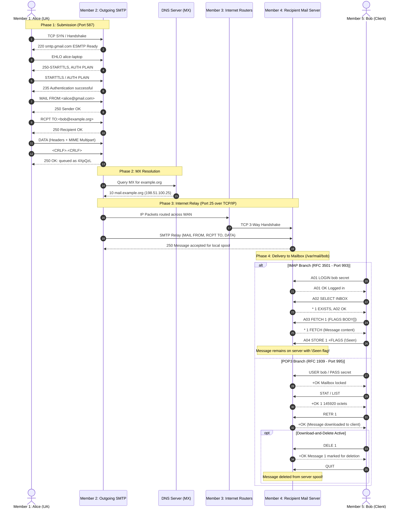

# ✉️ Email Communication Simulator: SMTP, POP3, and IMAP

<div align="center">


**An interactive, presentation-ready web demonstration for B.Tech Computer Networks**  
*Visualizing the internal protocol mechanics, command exchanges, server queues, internet routing, and access branching.*

[Live Demo](#-live-demo--quick-start) • [Five-Member Role Play](#-five-member-role-play-guide) • [Architecture](#-system-architecture--protocol-flow) • [Protocol Mechanics](#-deep-dive-protocol-mechanics) • [Classroom Projection Guide](#-presentation-mode-controls)

---

</div>

## 📌 Executive Summary

Email is an asynchronous, store-and-forward communication system operating across multiple layers of the TCP/IP suite. This simulator was built from the ground up for a **five-member Computer Networks group assignment and classroom role-play demonstration**.

Unlike basic mail forms, this application reveals what happens **internally at every stage** of email communication:
1. **User Agent (UA)** packaging RFC 5322 headers and MIME multipart attachments.
2. **SMTP Submission** (TCP port 587) with Extended Hello (`EHLO`), `STARTTLS` encryption, and `AUTH PLAIN`.
3. **MTA Queuing & DNS Resolution** via `MX` (Mail Exchange) queries.
4. **Internet Routing & TCP Handshake** between autonomous network systems.
5. **Incoming MTA & Persistent Mailbox Spooling** (`/var/mail/bob`).
6. **Dual Access Protocol Demonstration** on the exact same stored message:
   - **POP3 (RFC 1939)**: Download-and-delete local retrieval (`USER`, `PASS`, `STAT`, `LIST`, `RETR`, `DELE`, `QUIT`).
   - **IMAP (RFC 3501)**: Store-and-sync remote mailbox management (`LOGIN`, `SELECT`, `FETCH`, `STORE \Seen`, multi-device sync).

---

## 🚀 Live Demo & Quick Start

### 1. Run Completely Offline / Locally
No Node.js, Python, or external servers are required. The entire simulator is written in vanilla HTML, CSS, and JavaScript with zero external runtime dependencies:
1. Clone this repository:
   ```bash
   git clone https://github.com/melizabyiju/email-protocol-simulator.git
   cd email-protocol-simulator
   ```
2. Double-click **`index.html`** or open it in any modern browser (Chrome, Edge, Firefox, Safari).

### 2. Deploy to GitHub Pages
1. Go to repository **Settings** → **Pages**.
2. Under **Build and deployment** > **Source**, choose **Deploy from a branch**.
3. Select `main` branch and `/ (root)` folder, then click **Save**.
4. Your simulator is instantly live at:  
   `https://<username>.github.io/email-protocol-simulator/`

---

## 👥 Five-Member Role Play Guide

This application features a synchronized **Role-Play Presentation Mode** at the top of the interface. As the simulation animates through each stage, the speaker card automatically highlights the active member, displaying their live speech dialogue and key Computer Networks viva concepts.

```
+-----------------------------------------------------------------------------------------------+
|                                FIVE-MEMBER ROLE PLAY FLOW                                      |
+-------------------+-------------------+-------------------+-------------------+---------------+
| Member 1: Sender  | Member 2: SMTP    | Member 3: Network | Member 4: Recv    | Member 5:     |
| User Agent (UA)   | Outgoing Server   | Internet Routers  | Mail Server       | Client Access |
| - Composes mail   | - Push protocol   | - TCP port 25     | - Incoming MTA    | - POP3 vs     |
| - MIME & Headers  | - Queue & DNS MX  | - IP Hop routing  | - Mailbox Spool   |   IMAP branch |
+-------------------+-------------------+-------------------+-------------------+---------------+
```

### 👩‍💻 Member 1: Sender / User Agent (UA)
- **Role:** Alice / User Agent (UA)
- **Classroom Dialogue:**
  > *"Respected teacher and classmates, I represent Member 1, the Sender and User Agent. Whenever someone sends an email using an email client like Gmail, the User Agent handles the human interaction. It structures the email into standard RFC 5322 headers (From, To, Subject, Date) and uses MIME boundaries to encode attachments. Because email is a store-and-forward system, the UA does not contact Bob's computer directly; instead, it initiates an SMTP submission connection to its local outgoing mail server over TCP port 587."*
- **Key CN Concepts to Explain:**
  - Difference between User Agent (UA) and Mail Transfer Agent (MTA).
  - RFC 5322 header structure vs RFC 2045 MIME multipart encapsulation.
  - Why SMTP is a **Push Protocol** used for submission.

---

### 📮 Member 2: Sender's SMTP Server (Outgoing MTA)
- **Role:** Outgoing Mail Transfer Agent (`smtp.gmail.com:587`)
- **Classroom Dialogue:**
  > *"I am Member 2, representing the Outgoing SMTP Server. SMTP is the Simple Mail Transfer Protocol (RFC 5321). When Alice's client connects, I verify her identity with the AUTH PLAIN command over an encrypted STARTTLS channel. Once I accept the message data ending with `<CRLF>.<CRLF>`, I store it safely in my local Spool Queue. I then perform a DNS query for the MX (Mail Exchange) record of 'example.org' to determine the destination mail server."*
- **Key CN Concepts to Explain:**
  - Extended SMTP handshake: `EHLO`, `STARTTLS`, `AUTH PLAIN`.
  - Transaction phases: `MAIL FROM`, `RCPT TO`, `DATA`.
  - Spool Queue: Decoupling sender availability from recipient availability.
  - DNS MX Resource Records (`example.org IN MX 10 mail.example.org`).

---

### 🌐 Member 3: Internet & Network Layer
- **Role:** Intermediate Routers & TCP/IP Transport Layer
- **Classroom Dialogue:**
  > *"I am Member 3, representing the Internet Backbone and intermediate Routers. While SMTP operates at the Application Layer (Layer 7), it relies entirely on TCP (Layer 4) for reliable, ordered byte delivery. My network establishes a TCP 3-way handshake over port 25 between the two servers. My routers forward IP packets hop-by-hop across multiple Autonomous Systems, ensuring end-to-end delivery across the physical and logical internet."*
- **Key CN Concepts to Explain:**
  - Decoupling of Layer 7 (SMTP application text) and Layer 4/3 (TCP reliability, IP routing).
  - TCP 3-Way Handshake: `SYN -> SYN-ACK -> ACK`.
  - Packet encapsulation, router routing tables, and IP hops across Autonomous Systems (AS).

---

### 🏢 Member 4: Recipient Mail Server
- **Role:** Incoming Mail Transfer Agent (`mail.example.org:25`) & Mailbox Storage
- **Classroom Dialogue:**
  > *"I am Member 4, the Recipient Mail Server. My incoming SMTP listener receives the message relay on port 25, checks that 'bob.receiver' is a registered local mailbox, runs spam and malware checks, and deposits the email safely into Bob's server mailbox storage (/var/mail/bob). Because Bob's device might be turned off or offline, my server preserves the email until he retrieves it."*
- **Key CN Concepts to Explain:**
  - Role of the Mail Delivery Agent (MDA) writing to server disk (`Maildir` / `mbox`).
  - Recipient verification and bounce handling (`550 User not found`).
  - Persistent server mailbox storage.

---

### 📱 Member 5: Receiver Client (POP3 vs IMAP Access)
- **Role:** Bob / Mail Access Agent (MAA)
- **Classroom Dialogue:**
  > *"I am Member 5, representing Bob and the Mail Access protocols. Because SMTP is strictly a push protocol, a recipient cannot use SMTP to pull mail from their mailbox. Instead, we use either POP3 or IMAP. In POP3 (RFC 1939), the client downloads the message to local storage and issues a DELE command to remove it from the server. In IMAP (RFC 3501), the message stays on the server, allowing multiple devices like phones and laptops to stay synchronized with read/unread flags. Today we demonstrate both branches on the exact same stored message!"*
- **Key CN Concepts to Explain:**
  - Push protocol (SMTP) vs Pull protocols (POP3/IMAP).
  - POP3 (port 110/995): Download-and-delete vs Download-and-keep.
  - IMAP (port 143/993): Remote mailbox manipulation, folder hierarchy, `\Seen` flags, multi-device synchronization.

---

## 🏗️ System Architecture & Protocol Flow



---

## 🔬 Deep-Dive Protocol Mechanics

### 1. SMTP Command-Response Conversation (RFC 5321)
| Step | Direction | Command / Response | Technical Explanation |
|:---:|:---:|:---|:---|
| 1 | `S -> C` | `220 smtp.gmail.com ESMTP Ready` | Server service ready banner |
| 2 | `C -> S` | `EHLO client.local` | Extended Hello identifying client FQDN |
| 3 | `S -> C` | `250-STARTTLS` / `250-AUTH PLAIN` | Supported ESMTP extension keywords |
| 4 | `C -> S` | `AUTH PLAIN <base64>` | Submits Base64 encoded authentication credentials |
| 5 | `S -> C` | `235 Authentication successful` | Successful authentication verification |
| 6 | `C -> S` | `MAIL FROM:<alice@gmail.com>` | Establishes the envelope sender (return path) |
| 7 | `S -> C` | `250 2.1.0 Sender OK` | Confirms sender address accepted |
| 8 | `C -> S` | `RCPT TO:<bob@example.org>` | Establishes envelope recipient |
| 9 | `S -> C` | `250 2.1.5 Recipient OK` | Confirms recipient address accepted |
| 10 | `C -> S` | `DATA` | Initiates message body and headers transfer |
| 11 | `S -> C` | `354 Enter mail, end with "."` | Intermediate response requesting stream |
| 12 | `C -> S` | `.` (on single line) | End of message indicator (`<CRLF>.<CRLF>`) |
| 13 | `S -> C` | `250 2.0.0 OK: queued as 4XpQzL` | Server commits message to persistent spool |

### 2. POP3 vs. IMAP Comprehensive Comparison Matrix
| Parameter | POP3 (RFC 1939) | IMAP (RFC 3501) |
|:---|:---|:---|
| **Primary Philosophy** | **Download and Delete** (Local offline storage) | **Store and Sync** (Remote central mailbox) |
| **Default Ports** | Port 110 (Plaintext), Port 995 (POP3S over SSL/TLS) | Port 143 (Plaintext), Port 993 (IMAPS over SSL/TLS) |
| **Server Mailbox Retention** | Purged upon `QUIT` after `DELE` command | Persisted indefinitely; synced across all devices |
| **Multi-Device Support** | Poor (mail exists only on device that downloaded it) | Excellent (desktop, tablet, phone stay identical) |
| **Folder Hierarchy** | Single flat inbox on client | Hierarchical server folders (Inbox, Sent, Drafts, Archive) |
| **Message Flags** | None (only retrieved or not) | Rich states (`\Seen`, `\Answered`, `\Flagged`, `\Deleted`) |
| **Partial Fetching** | No (must download entire body and attachment) | Yes (can download headers only, or stream audio/PDF) |
| **Server Resource Overhead** | Minimal server storage needed | High server storage and CPU required |

### 3. MIME Structure (RFC 2045 & RFC 2046)
Because early SMTP only supported 7-bit US-ASCII, MIME wraps complex media using boundaries and Base64:
```http
MIME-Version: 1.0
Content-Type: multipart/mixed; boundary="----=_NextPart_001_847291"

This is a multi-part message in MIME format.

------=_NextPart_001_847291
Content-Type: text/plain; charset="utf-8"
Content-Transfer-Encoding: 7bit

Hello Bob, here is our CN project report.

------=_NextPart_001_847291
Content-Type: application/pdf; name="CN_Group_Report.pdf"
Content-Transfer-Encoding: base64
Content-Disposition: attachment; filename="CN_Group_Report.pdf"

JVBERi0xLjQKJcTl8uXrp/Og0MTGCjQgMCBvYmoKPDwKL0ZpbHRlciAvRmxhdGVEZWNvZGUK...
------=_NextPart_001_847291--
```

---

## 🎮 Presentation Mode Controls

| Control | Shortcut / Function | Description |
|:---|:---:|:---|
| **Send Email (Start)** | `Click / Enter` | Starts automated end-to-end simulation from Stage 1 to 5. |
| **Pause / Resume** | Spacebar / Button | Freezes current stage for questions or explanation. |
| **Next Step (Forward)** | `>` / Button | Advances one stage forward at a time. |
| **Prev Step (Backward)**| `<` / Button | Steps backward to revisit previous protocol events. |
| **Reset** | Button | Returns pipeline, queues, and terminal to initial state. |
| **Speed Slider** | `0.5x` to `3.0x` | Adjusts animation speed for quick review or detailed pacing. |
| **Protocol Switcher** | `IMAP` / `POP3` | Toggles the access protocol branch for Stage 5. |
| **POP3 Server Copy** | Checkbox | Demonstrates classic delete (`DELE`) vs server copy retention. |
| **MIME Inspector** | Modal Button | Displays raw multipart headers and Base64 attachment stream. |
| **Role-Play Script** | Modal Button | Full transcript of all 5 team members' presentation parts. |

---

## 📁 Repository Structure

```
email-protocol-simulator/
├── index.html        # Clean, accessible semantic layout and UI modals
├── style.css         # Modern blue-and-white projector theme & SVG wire animations
├── script.js         # Modular protocol state engine, terminal logger & stepper
└── README.md         # Comprehensive project documentation & role-play guide
```

---

## 🎓 Academic Viva Questions Answered by this Project

1. **Why can't SMTP be used by a client to retrieve emails?**  
   *Answer:* SMTP is strictly a **push** protocol. It requires the receiving server to be listening continuously on a well-known port (25/587). A personal laptop or smartphone does not have a permanent IP address and is frequently offline, so it must use a **pull** protocol (POP3 or IMAP) to request messages stored on the mail server.

2. **What is the difference between an email header and the SMTP envelope?**  
   *Answer:* The envelope is specified by the SMTP commands `MAIL FROM:<...>` and `RCPT TO:<...>` used by mail servers for delivery. The email headers (`From:`, `To:`, `Subject:`) are part of the message payload inside the `DATA` block and are rendered by the User Agent.

3. **Why do we need DNS MX records instead of standard A records?**  
   *Answer:* An email address contains a domain name (e.g. `@example.org`), which may point to a web server IP via an `A` record. The `MX` record allows organizations to designate separate, dedicated mail servers (often with backup priority rankings) to receive incoming mail.

---

## 📄 License & Attribution

Developed for B.Tech Computer Networks Group Role-Play Demonstration.  
Open-source educational resource distributed under the **MIT License**.
